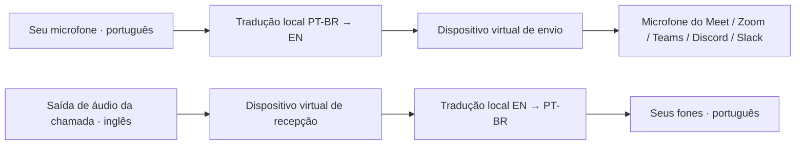

# Tradução em chamadas

O modo **Chamada**, na aba **Áudio**, tem dois caminhos independentes:

O reconhecimento, a tradução e a síntese continuam locais. O aplicativo da chamada
transmite a voz em inglês que você escolheu enviar. A chamada em si precisa de rede;
“processamento offline” não significa que Meet, Zoom ou outros serviços funcionem
sem internet. O tradutor não entra em reuniões, acessa contas nem controla o mute da chamada.

## Configuração dos dispositivos

O modo nativo cria dois dispositivos Core Audio **durante o uso do app**:
**LocalVoiceTranslator Microphone** e **LocalVoiceTranslator Speakers**. Não usa
instalador, senha de administrador, reinicialização ou driver de terceiros.

Na versão **0.2.1**, escolha primeiro seu microfone e seus fones e confirme o uso de
fones. Clique em **Preparar áudio da chamada**, sempre visível no rodapé. Não há
seletores vazios de envio/recepção antes da preparação. Eles aparecem preenchidos
quando os dois dispositivos são publicados. O app verifica essa publicação usando a
mesma lista que alimenta os seletores; uma falha aparece junto ao botão.
Se a preparação não avançar, confira a mensagem no rodapé: ela identifica microfone,
fones ou confirmação ausente, saída incompatível ou erro do Core Audio.
Não use o mesmo dispositivo nos dois sentidos: isso pode causar retorno.

O modo exige macOS 14.2+ e saída estéreo separada do microfone (por exemplo, External
Headphones). Dispositivos Bluetooth que expõem entrada/saída no mesmo UID ainda não
são suportados. A restrição evita incluir o microfone físico na entrada que deve conter
somente a voz traduzida. O modo Presencial continua disponível no macOS 14+.

| Onde configurar | Campo | Seleção neste exemplo |
|---|---|---|
| LocalVoice → Áudio → Chamada | Seu microfone | Seu microfone físico |
| LocalVoice → Áudio → Chamada | Enviar inglês à chamada | LocalVoiceTranslator Microphone |
| LocalVoice → Áudio → Chamada | Receber áudio da chamada | LocalVoiceTranslator Speakers |
| LocalVoice → Áudio → Chamada | Ouvir português nos fones | Seus fones físicos |
| Aplicativo da chamada | Microfone / Input | LocalVoiceTranslator Microphone |
| Aplicativo da chamada | Alto-falante / Output | LocalVoiceTranslator Speakers |

1. Conecte seus fones. Na aba Áudio, selecione **Chamada**, escolha seu microfone
   físico e seus fones e confirme o uso de fones.
2. Clique em **Preparar áudio da chamada**. Aguarde o estado preparado. O macOS pode
   pedir permissão de captura de áudio do sistema ao começar a usar os dispositivos;
   essa permissão não instala componentes. Os campos Enviar/Receber serão preenchidos.
3. Abra as configurações de áudio do aplicativo de chamada e escolha o microfone
   e a saída indicados na tabela. Os nomes dos menus variam entre aplicativos.
4. Desative o monitoramento/teste contínuo do próprio microfone no aplicativo de
   chamada, pois esse recurso devolve o inglês sintetizado à entrada da reunião.
5. Em Conversation, clique em **Iniciar escuta** e conceda acesso ao microfone
   quando o macOS solicitar. Deixe o microfone da chamada aberto para enviar a tradução.
6. Faça uma chamada de teste: você diz uma frase em português; a outra pessoa
   verifica o inglês. Ela responde em inglês; você verifica o português nos fones.

Se quiser voltar a falar sem tradução, pare o tradutor e restaure o microfone e os
fones nas configurações da chamada. STOP silencia as duas saídas e limpa a sessão;
ele não restaura automaticamente configurações de outros aplicativos. Os dispositivos
nativos permanecem disponíveis até **Desativar áudio nativo da chamada** ou **Sair (⌘Q)**.
Antes de removê-los, restaure microfone/fones na chamada: aplicativos podem escolher
o microfone físico automaticamente quando um dispositivo desaparece.

O app remove apenas os objetos que criou. Uma segunda instância não pode assumir
os dispositivos da primeira. Após encerramento forçado/crash, agregados públicos
podem permanecer no estado gerenciado pelo macOS: remova somente os dois agregados
LocalVoiceTranslator na Configuração de Áudio MIDI antes de preparar novamente.
Registros normais de permissões do macOS podem permanecer. Não se promete zero
estado no sistema; não são instalados arquivos em `/Library/Audio/Plug-Ins/HAL`.

## Compatibilidade e limites

- Meet, Zoom, Teams, Discord e Slack são alvos desta conexão por dispositivos.
  **Cada um ainda precisa de um teste real**; o teste com WAV não comprova essa integração.
- No navegador, selecionar uma saída específica depende do navegador e do site.
  Se a opção não existir, use uma versão que permita selecionar ambos os dispositivos
  ou o aplicativo nativo. O tradutor não altera a saída padrão global do Mac.
- Alguns aplicativos lidam mal com dispositivos de muitos canais. Se BlackHole
  16ch não aparecer ou não funcionar, será necessário um segundo dispositivo virtual
  estéreo com UID próprio, conforme a documentação do fornecedor. Esse caso não foi validado.
- O áudio original da reunião vai ao tradutor; este modo não mistura também o
  inglês original nos seus fones. Sua voz original não é misturada ao envio em inglês.
- Use fones: os caminhos personalizados não usam o cancelamento acústico VPIO do
  modo presencial padrão. O filtro digital não é prova de isolamento acústico.
- Há atraso de reconhecimento/tradução/voz. Fale em unidades curtas e aguarde a
  resposta. Duas direções têm filas próprias; falas de vários participantes dentro
  da mesma direção continuam sendo reproduzidas uma por vez.
- O reconhecimento compartilha um modelo Whisper com acesso serializado; cada
  caminho mantém seu próprio contexto, diarização, tradução, TTS e playback.
- PT-BR é esperado no seu microfone; inglês é esperado na recepção. Uma fala no
  outro idioma é sinalizada e não produz voz naquele caminho.
- Silenciar o microfone da reunião interrompe o envio aos participantes, mas não
  a captura local pelo tradutor. Para encerrar a captura local, use STOP.
- Desconectar ou alterar um dispositivo encerra a sessão; não há troca silenciosa
  para outro microfone ou saída. Pare a sessão antes de mudar seleções.

## Alternativa externa preparada, não instalada

O modo nativo acima não precisa deste pacote. Como alternativa externa de desenvolvimento,
`LocalVoiceTranslator-Audio.pkg` contém duas compilações independentes de BlackHole
0.7.1, commit `e2b22aaaba4e507a097131704bf96dabc004d9cf`, com nomes e UIDs próprios.
O código C não foi alterado; cada bundle recebe um UUID de fábrica distinto.
`scripts/build-call-audio-driver.py` reproduz a compilação. Os bundles têm assinatura
ad-hoc; o pacote **não é assinado por Developer ID nem notarizado**. Não se desativa
Gatekeeper ou outra proteção para instalá-lo. O teste em processo dos bundles passou
para PCM estéreo, canais independentes, retorno ao início do buffer, silêncio sem
produtor e STOP. Carregamento pelo HAL e uso em aplicativos continuam **PENDING**.

O pacote escreve somente seus dois bundles em `/Library/Audio/Plug-Ins/HAL`, além
dos registros gerenciados pelo Instalador; exige administrador e solicita reinicialização.
Não contém scripts de instalação, não reinicia Core Audio e não altera dispositivos
padrão. A instalação permanece dependente da autorização explícita para a exceção
à restrição de instalações globais. Não abra o pacote durante os testes contínuos.

São componentes GPL-3.0 separados, sem vínculo ao executável do tradutor. Licença
nos bundles; fonte correspondente em `artifacts/LocalVoiceTranslator-Audio-source.tar.gz`;
hashes/identificadores em `artifacts/call-audio-driver.json`. Uso pessoal; distribuição
comercial não foi preparada. Para remoção manual, remova apenas os bundles
`LocalVoiceTranslatorMicrophone.driver` e `LocalVoiceTranslatorSpeakers.driver`
desse diretório pelo Finder com autorização de administrador e reinicie o Mac.

### Alternativa com os pacotes oficiais BlackHole

Os pacotes oficiais BlackHole **0.7.1**, 2ch e 16ch, foram baixados para
`tools/downloads/audio-routing/`. `manifest.json` registra origem, tamanho e SHA-256.
`pkgutil --check-signature` confirmou assinatura **Existential Audio Inc. (Q5C99V536K)**
e confiança da notarização Apple para ambos. A licença GPL-3.0 acompanha os pacotes;
eles são opcionais e ficam fora do bundle do tradutor e do seu DMG.
Nesse caso, configure manualmente **BlackHole 2ch** para envio/microfone da chamada
e **BlackHole 16ch** para recepção/saída da chamada, canais 1 e 2. Não renomeie
arquivos dos pacotes oficiais para tentar mudar o nome do dispositivo.

A instalação exige administrador e escreve em `/Library/Audio/Plug-Ins/HAL`, além
dos registros usuais do instalador macOS. Os scripts oficiais ajustam proprietário
e permissões dos diretórios BlackHole existentes nesse local. Os pacotes solicitam
reinicialização. Nada disso foi executado pelo agente: a regra anterior proíbe
instalações globais e precisa de uma exceção explícita para esta etapa.

## Evidência nativa, sem driver externo

`artifacts/latency-speaker-review/native-duplex.jsonl` registra o teste do controlador
nativo de produção em um app com App Sandbox e um segundo processo simulando a chamada.
As duas direções receberam PCM sintético distinto, com verificação de amplitude,
visibilidade dos dispositivos em outro processo e limpeza dos objetos criados.
A comparação admite o overshoot de conversão de frequência do HAL na borda de um
sinal constante; não compara áudio real a valores exatos de um teste artificial.

O controlador usa taps limitados ao dispositivo escolhido: a entrada da chamada
exclui o processo do tradutor; o microfone virtual recebe somente a saída em inglês
desse processo no dispositivo de envio. Não captura indiscriminadamente o áudio de
todos os aplicativos. São testes de transporte de PCM, não de uma reunião remota.

## Evidência e aceitação

`artifacts/call-routing-golden.jsonl` testa dois AudioCore de produção ao mesmo
tempo, mesma fixture bilíngue entregue a ambas as entradas, destinos PT/EN separados,
PCM em 44,1/48 kHz, captura durante playback, filas, orçamento global e STOP.
É uma fixture **sintética**, sem driver virtual ou aplicativo de reunião.
As validações físicas, de instalação e por aplicativo continuam em
`docs/MANUAL_VALIDATION.md`. O modo não deve ser considerado validado em chamadas
até esses resultados serem registrados.

Referências: [roteamento e instalação oficiais do BlackHole](https://github.com/ExistentialAudio/BlackHole),
[dispositivos BlackHole independentes](https://github.com/ExistentialAudio/BlackHole/wiki/Running-Multiple-BlackHole-Drivers),
[seleção de dispositivos no Google Meet](https://support.google.com/meet/answer/10409699),
[seleção de dispositivo por Audio Unit no macOS](https://developer.apple.com/documentation/audiotoolbox/auaudiounit/setdeviceid(_:)).

### Precisão em sessões repetidas

Um ensaio anterior de 30 minutos, sem perdas nas filas, falhou em uma repetição:
“reunião” foi reconhecida como “reunir”. Aumentar o beam de 5 para 8 não resolveu
(2/20 falhas nesse recorte) e foi rejeitado. O código mantém beam 5 e preserva até
500 ms de áudio anterior à fala no modo streaming, em vez de 150 ms. No recorte
avaliado, 20/20 repetições mantiveram “reunião”; isso não substitui o novo ensaio
completo. A duração máxima do segmento permanece limitada. Evidências:
`asr-beam8-comparison.jsonl`, `asr-preroll500-comparison.jsonl` e
`soak-before-streaming-preroll.jsonl/.err`. O status atual está no relatório final.

Um teste adicional deslocou a entrada remota para ter PT e EN realmente simultâneos.
`artifacts/call-opposing-directions.jsonl` registrou PASS, com 227 blocos de 20 ms
(4,54 s) em que as duas saídas reproduziam voz ao mesmo tempo, mantendo captura.
A fonte derivada e os hashes estão em `call-opposing-provenance.json`. Esse teste
usa o motor de produção com WAVs, sem cabos virtuais ou chamada remota.
