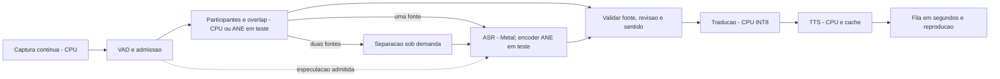

# Estudo de eficiência, CPU/GPU e naturalidade da conversa

25/09/2026. **Somente estudo: nenhuma alteração de implementação, configuração,
modelo ou pacote.** Análise dos fontes, inspeção estática dos modelos ONNX, releitura
dos registros locais e consulta à documentação primária. Não foram executados novos
benchmarks de inferência, builds, gravações ou testes físicos.

Referência registrada do projeto: Apple M2 Pro, Whisper small F16/Metal,
CTranslate2 INT8/CPU e Piper/VITS/CPU. O número de núcleos do computador ativo não
foi revalidado; este estudo não fixa afinidade nem presume uma variante específica
do M2 Pro. Fingerprint dos fontes examinados:
`a418ec98f86fd9f89563df25817abe5cbe36050af6715800205b4ca6be18f5ba`.

**Requisito esclarecido pelo usuário: sensação de chamada com 45–75 ms.** Esse é
o objetivo de experiência solicitado, ainda sem viabilidade demonstrada para
tradução livre PT-BR/EN. As metas anteriores de 1–2 s são marcos intermediários de
engenharia e não comprovam esse requisito. Não redefinir aprovação como apenas
latência de TTS, tempo de rede ou áudio original encaminhado sem tradução.

Uma chamada comum transporta áudio; tradução acrescenta necessidade de contexto,
reconhecimento, conversão de idioma e síntese. Medir separadamente transporte/I/O,
atraso de conteúdo durante fala contínua e resposta após a última palavra. Um
trecho previsto pode estar pronto rapidamente quando a frase termina, mas isso
não demonstra atraso de 45–75 ms ao longo de uma conversa livre. Hardware acelera
cálculos; não elimina a necessidade de ouvir palavras futuras que definem sentido.
O compromisso entre contexto e atraso está documentado em
[STACL](https://aclanthology.org/P19-1289/); esse trabalho não valida tal meta em PT/EN.

O estudo deve comparar arquiteturas realmente incrementais se a prioridade for
aproximar essa experiência. Não há evidência suficiente para prometer que os ajustes
do pipeline atual alcançarão 45–75 ms. A conclusão pode ser inviabilidade sob os
requisitos simultâneos de precisão, idiomas, processamento local e hardware escolhido.

**Decisão recomendada.** Priorizar eliminação de trabalho repetido, confirmação
correta dos trechos e agendamento por demanda real. Depois comparar a distribuição
CPU + Metal com CPU + Metal + Neural Engine. A maior utilização dos processadores
não é o objetivo: interessa reduzir o tempo até a voz correta, com atraso previsível,
captura contínua e sem aquecimento que degrade uma chamada longa.

Zero atraso literal não é viável: a tradução precisa receber informação suficiente
para preservar sentido e ordem das palavras. Podemos sobrepor o processamento à
fala, reduzir a espera adicional e evitar pausas artificiais. Unidades curtas,
confiáveis e com prosódia contínua são preferíveis a começar cedo com palavras erradas.

**Estado de qualidade que condiciona a otimização.** A última bateria completa
registrada da revisão examinada falhou em `scenario-speech-noise`: foi falado
“vamos começar a reunir”, e o reconhecimento final corrigiu para “vamos começar a
reunião”. O checkpoint aprovado das 16:49 UTC de 12/09 pertence à revisão anterior.
Logo, os resultados de velocidade abaixo não aprovam o aplicativo atual. A falha
está preservada em [rejected-noise](../artifacts/asr-arbitration/rejected-noise/status.json).

**Onde o processamento já acontece**

| Etapa | Implementação examinada | Implicação |
|---|---|---|
| Captura/reprodução | Core Audio/AVAudioEngine; tap solicitado de 1.024 frames; processamento VAD em blocos de 20 ms | Proteger os callbacks; não colocar inferência ou carregamento neles |
| Reconhecimento | Whisper.cpp 1.8.3, Metal ligado, flash attention, até quatro threads CPU, beam 5 | CPU e GPU já trabalham; Core ML está desligado no build |
| Participantes/overlap | ECAPA512 e Pyannote, ONNX CPU, duas threads por sessão | Ocorrem antes do ASR de cada revisão; custo repetido no caminho da resposta |
| Separação | Conv-TasNet CPU, duas threads, sob demanda e apenas no final | Overlap tem custo e espera adicionais; não equivale à conversa de uma voz |
| Tradução | CTranslate2 4.8.0, INT8/Ruy, quatro threads por réplica, beam 4 | Já existe uma configuração CPU medida; Accelerate está compilado para FP32 |
| Síntese | Sherpa/Piper CPU, duas threads, cache limitado de vozes | Inferência, carga da voz e duração reproduzida são custos diferentes |
| Saída | Um áudio falado por caminho; filas com duração pendente | GPU mais rápida não encurta uma fala que já ocupa a saída |

Fontes: [WhisperASR](../engine/asr/WhisperASR.cpp),
[ASRWorker](../engine/asr/ASRWorker.cpp), [ONNX](../engine/common/OnnxModel.hpp),
[tradução](../engine/translation/TranslationEngine.cpp),
[TTS](../engine/tts/TTSEngine.cpp),
[pipeline](../engine/conversation/ConversationPipeline.cpp).

**O que os registros permitem afirmar**

Faixas abaixo extraídas novamente dos eventos já existentes, sem nova execução.
São observações exploratórias, não percentis nem medições acústicas. A deduplicação
usa o timestamp de início de cada etapa, para não contar o mesmo ASR em vários
eventos da interface. Trabalhos sem evento publicado não estão nessas faixas.

| Etapa | Conversa sintética adaptativa | Golden humano adaptativo |
|---|---:|---:|
| Diarização, incluindo trabalho anterior ao Whisper | 37–146 ms, 19 análises | 41–151 ms, 11 análises |
| Mel externo ao `whisper_full` | 0,9–7,7 ms, 19 chamadas | 0,9–2,9 ms, 11 chamadas |
| Detecção de idioma, incluindo encoder | 122–192 ms, 19 chamadas | 114–147 ms, 11 chamadas |
| `whisper_full`, rotulado hoje como `decodeMs` | 159–284 ms, 19 chamadas | 151–281 ms, 11 chamadas |
| Tradução | 70–226 ms, 5 unidades | 151–197 ms, 3 unidades |
| Síntese, sem carga da voz | 90–289 ms, 5 unidades | 141–299 ms, 3 unidades |
| Carga da voz dentro do caminho TTS | 0–581 ms, 5 unidades | Aproximadamente zero, 3 unidades |
| Espera para iniciar reprodução | 0,9–1.707 ms, 5 unidades | 10–23 ms, 3 unidades |

Fontes: `artifacts/latency-policy/trim/fast-trim/conversation.jsonl` e `human.jsonl`.
No registro posterior `artifacts/scenario-overlap-two-english.jsonl`, a diarização
chegou a 614 ms e a espera de uma das duas saídas chegou a 3.343 ms. É outro ensaio,
com outra condição; não compor um suposto E2E somando extremos de tabelas diferentes.

O [ensaio isolado de cache](LATENCY_IMPLEMENTATION.md) evitou cerca de 0,47–0,52 s
em cinco de seis primeiras reproduções, com custo de preparação explícito. O
[ensaio de arbitragem](ASR_ARBITRATION.md) teve máximos de espera publicados de
338 ms no controle e 347 ms no candidato: prioridade sozinha não demonstrou
redução da cauda. Os 40–70 ms vistos ocasionalmente no TTS não representam toda a
espera da conversa.

**Gargalos e oportunidades, em ordem de impacto provável**

1. **Confirmação de sentido e cortes.** É a primeira restrição. Duas hipóteses
   iguais com áudio novo ainda podem estar erradas, como ocorreu com “reunir”.
   Pontuação e duas palavras seguintes não bastaram. Estudar evidência da fronteira,
   contexto/alinhamento e confiança calibrada; probabilidade de token isolada
   também não prova correção. Separar legenda provisória de autorização para TTS.
   Iniciar trabalho em pausas de 180/220/260 ms é um experimento válido, desde que
   retomadas invalidem o resultado antes de falar. Não trocar a regra de 120 ms
   das janelas longas por outra mais lenta sem comparação.

2. **Cálculo repetido dentro do Whisper.** O wrapper chama `whisper_pcm_to_mel`,
   depois `whisper_lang_auto_detect`, depois `whisper_full` com o mesmo PCM.
   No backend fixado, a detecção executa o encoder; `whisper_full` recalcula mel
   quando recebe amostras e executa novamente o encoder. Portanto, `decodeMs`
   não mede apenas decodificação de tokens. Priorizar reaproveitamento de mel e
   estudar uma integração que preserve probabilidades de idioma sem repetir o
   encoder. Isso exige teste da API/estado do backend, não simplesmente excluir
   a detecção. Evidência: [fontes do backend](../third_party/whisper.cpp/src/whisper.cpp),
   funções `whisper_lang_auto_detect_with_state` e `whisper_full_with_state`.
   A economia potencial de cada mudança precisa ser medida; o custo total de LID
   não é automaticamente removível, e eliminar mel sozinho poupa poucos ms.

3. **Cadência baseada em carga superestimada.** `estimatedDemandMs` multiplica
   o custo observado pelo número de workers registrados, incluindo um caminho
   silencioso. O custo soma diarização e Whisper, embora apenas o Whisper seja
   serializado pelo mesmo árbitro. Isso pode alongar parciais sem necessidade.
   Medir demanda ativa, filas e tempo ocupado por recurso; separar orçamento CPU
   de orçamento do ASR/Metal. Usar margens para finais e variação. Dois caminhos
   preparados não significam dois caminhos produzindo inferências continuamente.

4. **Reanálise de áudio antigo e participantes.** Cada parcial crescente volta à
   segmentação/embeddings. Pyannote recebe janelas preenchidas até 10 s, com avanço
   de 5 s; uma entrada curta já executa a janela preenchida. Cachear apenas janelas
   realmente idênticas e estabilizadas; a borda que ganha novo contexto precisa
   ser revista. Identidades conhecidas podem aproveitar evidência válida anterior,
   mas a criação de nova pessoa continua exigindo a corroboração atual, com pelo
   menos 2,4 s de evidência elegível. Isso é um limite relevante para a primeira
   voz de uma pessoa nova. Paralelizar ASR preliminar e análise de participante
   só é útil com admissão e junção por sessão/áudio/revisão; cortes ou overlap
   incompatíveis obrigam descarte do ASR especulativo, nunca fala de texto misturado.

5. **Busca de eco por força bruta.**
   [PlaybackReferenceHistory](../engine/audio/PlaybackReferenceHistory.hpp) mantém
   60.000 amostras a 2 kHz e compara uma consulta de 1.000 amostras em cada posição.
   Com histórico cheio e sem correspondência, são aproximadamente 59 milhões de
   pares de amostras examinados, além das verificações posteriores. É uma análise
   de complexidade, não uma medição de duração. Ela roda em worker, mas precede
   o ASR. Medir separadamente; avaliar busca por timestamps e faixa de atraso,
   somas acumuladas, vetorização Accelerate/vDSP ou correlação FFT. Preservar as
   provas contra supressão de outra pessoa e contra recursão. O contador atual
   `overlapMs` inclui o guard anterior ao Pyannote e também precisa ser separado.

6. **Disputa de CPU e espera por inferência ativa.** Tradução, ONNX, TTS e Whisper
   têm seus próprios workers/pools. A soma das configurações não é uma medição de
   núcleos simultaneamente ocupados, mas pode criar competição. Comparar 1/2/4
   threads por backend em situações completas, limitar inferências concorrentes
   por orçamento e medir spinning do ONNX. Um final em espera pode justificar
   cancelar cooperativamente uma parcial ativa; manter o cancelamento marcado
   até o fim da chamada e descartar toda saída interrompida. Medir trabalho perdido
   e recomputação para evitar alternância que reduza a vazão.

7. **Carga e fila de fala.** Preservar cache e preparação medidos. Evitar thrashing
   de vozes sem carregar indiscriminadamente os seis modelos. Preparar a voz do
   participante quando houver identidade confiável e margem de recursos. Reduzir
   a unidade de tradução/TTS por fronteira de sentido, com prosódia preservada.
   Se chegam 1,2 s de fala traduzida por segundo e a saída reproduz 1 s por segundo,
   a fila cresce 0,2 s por segundo mesmo com inferência instantânea. Ajuste opcional
   moderado de velocidade exige escuta; não omitir conteúdo nem interromper um
   trecho já falado para aparentar baixa latência.

8. **Buffers, cópias e alocações.** O tap de 1.024 frames equivale nominalmente a
   21,3 ms a 48 kHz, sem garantir essa entrega no dispositivo real. Comparar buffers
   menores somente depois de medir callbacks, AEC, conversões de frequência e
   underruns. Reusar PCM/features onde seguro e manter alocações fora do callback.
   Os `waitPopFor(250 ms)` são acordados por notificação: não constituem uma pausa
   obrigatória de 250 ms por item. Micro-otimizações aqui não explicam sozinhas
   vários segundos de espera.

**Como dividir CPU, GPU e Neural Engine**

| Trabalho | Destino inicial recomendado | Experiência que pode melhorar |
|---|---|---|
| Captura, VAD, buffers e reprodução | CPU; callbacks mínimos e previsíveis | Vetorização/menos cópias; preservar prazo do áudio |
| Eco e features | CPU/Accelerate | Busca com timestamps e correlação vetorizada, antes de avaliar GPU |
| Whisper | Metal, com apoio CPU | Encoder Core ML/ANE e decoder Metal; comparar com Metal atual |
| Embeddings/Pyannote | CPU como controle | Core ML CPU+ANE ou CPU+GPU, um modelo de cada vez, se houver cobertura útil |
| Tradução | CPU INT8/Ruy | Ajustar threads/concorrência; trocar backend só se MT dominar a espera |
| Piper/VITS | CPU, cache limitado | Core ML apenas se reduzir a resposta total e mantiver vozes/prosódia |
| Separação | Sob demanda, orçamento próprio | Core ML/GPU se o grafo for adequado e o ganho sobreviver à concorrência com ASR |

CPU, GPU e ANE usam a arquitetura de memória unificada do Apple Silicon. Executar
mais trabalhos ao mesmo tempo também aumenta tensores vivos, pressão de memória e
disputa por recursos; não somar RSS e memória Metal como se fossem necessariamente
alocações independentes. A Apple recomenda medir o benefício da concorrência e
limitar previsões em andamento. Fontes:
[Apple silicon e modelos](https://developer.apple.com/videos/play/wwdc2024/10159/),
[concorrência no Core ML](https://developer.apple.com/videos/play/wwdc2023/10049/).

CTranslate2 não oferece aqui um seletor Metal: a documentação lista GPU NVIDIA,
e o build local usa CPU/Accelerate/Ruy. Transferir a tradução para a GPU Apple
exigiria outro backend/representação e nova validação. No ensaio local de oito
frases por direção, INT8 já foi mais rápido que FP32. Fontes:
[hardware CTranslate2](https://opennmt.net/CTranslate2/hardware_support.html),
[opções de compilação](https://opennmt.net/CTranslate2/installation.html) e
[benchmarks locais](../BENCHMARKS.md).

Whisper.cpp documenta encoder Core ML/ANE. É a primeira alternativa de aceleração
a experimentar porque já existe na família do backend adotado. O ganho anunciado
contra CPU não pode ser transferido para nossa comparação contra Metal. Preparação
fria e compilação inicial também contam.
[Documentação oficial](https://github.com/ggml-org/whisper.cpp#core-ml-support).

Core ML permite restringir unidades de cálculo, mas habilitar ANE não garante que
todo operador execute nele. O provedor ONNX requer integração explícita e é ausente
na biblioteca local fixada. Avaliar particionamento, conversões, formas de entrada,
cache de compilação e os operadores que continuam na CPU. A própria documentação
alerta para custo com formas dinâmicas e preparação sem cache.
[ONNX Runtime/Core ML](https://onnxruntime.ai/docs/execution-providers/CoreML-ExecutionProvider.html).

Inspeção estática dos modelos locais, sem inferência: Pyannote contém quatro nós
LSTM e um `If`; ECAPA usa entrada `[B,T,80]`, pooling e operações de forma; Conv-TasNet
usa `[batch,time]`, `If`, `ConvTranspose` e operações dinâmicas. Esses fatos impedem
presumir aceleração integral a partir da extensão `.onnx`. Fixar uma forma pode
ajudar a compilação, mas acrescentar padding ao ECAPA pode mudar features e identidade.
Qualquer conversão precisa comparar saídas e decisões com as entradas originais.

Testar pools e spinning como configuração conjunta, não maximizar threads de cada
modelo isoladamente. ONNX documenta pools globais e o compromisso entre spinning,
consumo e resposta; CTranslate2 distingue paralelismo interno e entre trabalhos.
[ONNX threading](https://onnxruntime.ai/docs/performance/tune-performance/threading.html),
[CTranslate2 parallelism](https://opennmt.net/CTranslate2/parallel.html).

Dar prazo ao áudio não significa colocar toda inferência em prioridade de tempo
real. Os threads de áudio fornecidos pelo sistema já participam dos workgroups
apropriados; workgroups adicionais fazem sentido para DSP auxiliar realmente
vinculado ao prazo. Não reservar um núcleo por modelo nem fixar todos os workers
nos mesmos núcleos de desempenho sem evidência.
[Apple Audio Workgroups](https://developer.apple.com/videos/play/wwdc2020/10224/).

**Fluxo recomendado para os experimentos**

As etapas trabalham sobre trechos diferentes ao mesmo tempo. Para o mesmo trecho,
as dependências continuam existindo. O caminho tracejado é proposta: áudio só pode
ser liberado depois da validação da fonte, da identidade e do texto. Emissões de
fontes separadas continuam ordenadas quando compartilham uma saída.

**Experimentos em sequência, com critérios de decisão**

| Ordem | Comparação | O que decide |
|---|---|---|
| 0 | Baseline repetido e regressão de “reunir/reunião” | Medições reproduzíveis; nenhuma aprovação enquanto o erro já falado persistir |
| 1 | Mel/encoder repetidos, eco e carga ativa | Menor trabalho e espera reais, mantendo texto, identificação de idioma e proteção de eco |
| 2 | Cadência por recurso; cache de análise; cancelamento de parcial | P95 de espera, custo cancelado, justiça dos caminhos, sem perda de final |
| 3 | Threads CPU 1/2/4 e spinning/pools | Melhor resposta sustentada em chamada, não só melhor benchmark isolado |
| 4 | Whisper Metal contra encoder Core ML/ANE | Frio/quente, ASR completo, memória, energia/estado térmico e qualidade PT/EN |
| 5 | ONNX CPU contra Core ML, por modelo | Cobertura de operadores e benefício do pipeline justificam custo de conversão |
| 6 | Pausa antecipada e unidades de sentido | Redução após última palavra sem cortes falsos, erros críticos ou pior prosódia |
| 7 | Melhor combinação em conjunto reservado e chamadas | Cumprimento das metas abaixo e testes físicos/offline |

Se essas etapas não atingirem as metas, comparar um backend nativo voltado a
streaming, ou WhisperKit/Core ML, mantendo PT-BR/EN, processamento local e <8 GiB.
Uma troca precisa levar junto idioma, timestamps, cancelamento, participantes e
empacotamento offline. Quantizar o small ou reduzir beam são experimentos posteriores
de velocidade/precisão, não substituições automaticamente aprovadas. Tiny/Base já
perderam precisão nos testes locais; aumentar agressividade agora pode repetir isso.
[WhisperKit oficial](https://github.com/argmaxinc/WhisperKit).

Concordância local e buffers alinhados têm fundamento em
[Whisper-Streaming](https://aclanthology.org/2023.ijcnlp-demo.3.pdf); o compromisso
entre contexto e atraso aparece em [STACL](https://aclanthology.org/P19-1289/).
Esses trabalhos não certificam uma política numérica para este Mac, estes modelos
ou tradução com voz. Não reutilizar um cache de encoder bidirecional como se fosse
um estado causal de streaming sem verificar o contrato do modelo.

Documentação externa pode descrever versões posteriores às dependências fixadas;
cada opção deve ser conferida na versão usada antes da implementação. Conversões
seriam feitas no ambiente local de desenvolvimento e os recursos seriam incluídos
no aplicativo, preservando execução nativa e ausência de downloads durante o uso.

**Objetivos mensuráveis de naturalidade e eficiência**

L0–L8 do [estudo anterior](LATENCY_STUDY.md) permanecem como marcos intermediários
e salvaguardas. Cumpri-los não aprova o objetivo de experiência de 45–75 ms:

| Marco intermediário ou salvaguarda | Critério |
|---|---|
| Espera após fim acústico real | P50 ≤1,2 s; P95 ≤2 s, por direção, modelo aquecido, fala limpa e saída livre |
| Detecção de encerramento | P50 ≤350 ms; P95 ≤500 ms; cortes falsos ≤1%; nenhum novo corte crítico |
| Início de voz durante fala contínua | P50 ≤3,5 s; P95 ≤5 s, em unidades com sentido completo em até 3 s |
| Fila de reconhecimento | P95 ≤250 ms sob carga nominal, sem esconder cancelamentos nem descartar finais |
| Ganho da combinação | Pelo menos 25% na mediana após fim da fala, sem piora de P95; baseline absoluto publicado |
| Qualidade | Zero novos erros críticos de sentido; WER agregado +≤1 ponto percentual e por idioma +≤2 pontos |
| Continuidade | Nenhum novo ID duplicado, áudio repetido, recursão ou alteração silenciosa de texto já falado |
| Recursos | Footprint dos componentes locais <8 GiB; sem crescimento progressivo, underruns ou fila divergente |
| Uso sustentado | 30 min presencial +30 min duplex na revisão final; testes físicos, dispositivos e offline |

Relatar primeira identificação de uma pessoa separadamente das identidades já
conhecidas, sem excluí-la silenciosamente do resultado geral. Separar também modelo
frio/quente, fones/alto-falante, fala limpa/ruído/overlap e saída livre/ocupada.
As metas de saída livre não se aplicam ao tempo gasto ouvindo outra tradução.

O corpus preparado contém 120 novas gravações humanas, com desenvolvimento e
avaliação reservada por idioma. Ainda exige limites acústicos anotados, revisão de
sentido e comprovação dos participantes/sotaques. Usar pelo menos 30 amostras por
população para publicar P50/P95; repetições da mesma frase não representam novas
pessoas. Repetir A/B em ordem alternada com PCM/silêncios idênticos, sem builds
concorrentes, e incluir uma condição com aplicativo de chamada em uso. Medir por
Instruments/Metal/System Trace a ocupação e as esperas antes de escolher destinos.

O estudo conclui a análise e a ordem de experimentos. Não demonstra latência zero,
não aprova a política atual que falhou em ruído e não altera a implementação.
