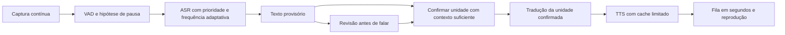

# Estudo de latência e corte de fala — LocalVoiceTranslator

Data: 12/09/2026. Referência: versão 0.2.1, M2 Pro, Balanced, Whisper small/Metal,
tradução INT8/CPU e Piper local. **Estudo concluído; implementação em andamento,
metas finais ainda não comprovadas.** O acompanhamento atual está em
[LATENCY_IMPLEMENTATION.md](LATENCY_IMPLEMENTATION.md). As medições completas usadas aqui são anteriores;
nesta investigação foram executados sete casos isolados das políticas de produção.
O diagnóstico abaixo descreve o baseline do estudo. As mudanças posteriores de
cache, cadência e estabilidade, com seus resultados e limitações, estão em
[STREAMING_EVALUATION.md](STREAMING_EVALUATION.md); não devem ser confundidas com
as configurações históricas descritas aqui.

**Decisão recomendada**

Priorizar instrumentação, confirmação por unidades de sentido e agendamento adaptativo
do reconhecimento. Antecipar trabalho durante pausas curtas; manter um cache pequeno de
vozes. Preservar inicialmente os modelos, as regras de identidade vocal, o processamento
local e o limite de 8 GiB. Essa é a estratégia inicial mais sustentada pelas evidências;
a configuração numérica vencedora depende dos experimentos abaixo.

Não adotar atualização fixa a cada 500 ms para todos os caminhos, corte obrigatório a
cada dois segundos ou troca imediata para um Whisper menor. Não há evidência de que
essas opções cumpram simultaneamente precisão e latência neste aplicativo.

**Objetivos que precisam ser cumpridos**

Atualização de requisito em 25/09/2026: o usuário pediu sensação de chamada com
45–75 ms de atraso. As metas numéricas abaixo são marcos intermediários; cumpri-las
não satisfaz esse novo objetivo. A distinção entre transporte, atraso de conteúdo
traduzido e viabilidade está no [estudo CPU/GPU](CPU_GPU_LATENCY_STUDY.md).

Todos os valores abaixo são **metas propostas**, não resultados atingidos. P50 é a
mediana; P95 é o valor abaixo do qual ficam 95% das amostras. Publicar percentis somente
com pelo menos 30 amostras na população correspondente, sem juntar idiomas ou condições.

| ID | Objetivo | Critério de aprovação | Estado |
|---|---|---|---|
| L0 | Medir a espera depois que a pessoa termina | Rastrear fim acústico da unidade, corte, confirmação, filas, inferências e início da voz; 100% das unidades aceitas e dos descartes contabilizados | Parcial: timestamps e estimativa VAD implementados; referência acústica e contabilidade completa pendentes |
| L1 | Responder após uma pausa clara | Fim acústico → primeiro PCM audível: P50 ≤ 1,2 s e P95 ≤ 2,0 s, por direção, em fala limpa, modelo aquecido e sem fala anterior em reprodução | Não medido |
| L2 | Cortar sem esperar excessivamente | Fim acústico → encerramento da unidade: P50 ≤ 350 ms e P95 ≤ 500 ms nas pausas finais anotadas; cortes falsos ≤ 1% e nenhum novo corte que altere sentido no conjunto crítico | Não medido |
| L3 | Traduzir durante fala contínua | Início da unidade de sentido → primeira voz: P50 ≤ 3,5 s e P95 ≤ 5 s no conjunto com unidades semanticamente completas em até 3 s; manter resultados separados para orações longas | Não medido |
| L4 | Preservar conteúdo e reconhecimento | Zero novos erros críticos de negação, valores, datas ou nomes frente ao baseline; WER agregado não piorar mais de 1 ponto percentual e nenhum idioma mais de 2 pontos; revisão de sentido obrigatória | Pendente |
| L5 | Preservar participantes e continuidade | Zero novos IDs duplicados nos casos de voz única; cobertura de identificação não inferior ao baseline; zero duplicações de áudio, recursão ou alterações em texto já falado | Pendente |
| L6 | Evitar que a pressa crie fila | Sob carga nominal, espera pelo ASR P95 ≤ 250 ms; uma parcial pendente por caminho, substituída pela mais recente; finais sem perdas; medir também espera de playback em segundos | Não medido |
| L7 | Respeitar recursos e STOP | Footprint total dos componentes locais < 8 GiB; admissão antes de carregar caches; STOP invalida PCM imediatamente e pedido não bloqueia por mais de um bloco de 20 ms no teste nativo | Revalidar após mudanças |
| L8 | Sustentar o ganho no uso real | Repetir 30 min presencial e 30 min duplex, sem crescimento progressivo/filas; validar microfone/fones, interrupções e aplicativos de chamada antes de declarar ganho real | Pendente |

L1 não promete dois segundos desde o começo de qualquer frase. Uma frase longa pode
precisar de contexto adicional. Também não promete vencer áudio anterior já em reprodução.
Todas as amostras excluídas de L1 precisam aparecer no relatório de fila/carga, com motivo.
Erros críticos que já existem, como a tradução de “João” para “John” registrada no
baseline, continuam pendentes: “zero novos erros” não significa qualidade perfeita.

**O que sabemos hoje**

| Evidência registrada | Resultado | Limite da conclusão |
|---|---|---|
| Presencial, 30 min, 181 amostras | Captura inicial → primeira voz: P50 7,25 s; P95 9,03 s | Inclui duração/contexto da fala; não é a espera depois da última palavra |
| Chamada PT→EN, 30 min | P50 6,98 s; P95 8,68 s | Pipeline com WAV; não inclui rede nem dispositivo físico de uma reunião |
| Chamada EN→PT, 30 min | P50 8,12 s; P95 8,64 s | Mesmo limite; as duas direções competem pelo ASR |
| 54 sínteses de voz | Inferência 24–240 ms; carga de voz 469–710 ms | Textos/vozes diferentes; não somar extremos como previsão de E2E |
| Tentativa anterior de parciais a 750 ms | Primeiro áudio ~5,04 s em ensaio curto; falhou em fala com ruído | Configuração rejeitada; melhora de velocidade não aprovou precisão |

Fontes locais: [medições](../BENCHMARKS.md), [revisão anterior](AUDIO_REVIEW.md),
[resumo com hashes](../artifacts/latency-study/evidence.json) e
[falha da tentativa a 750 ms](../artifacts/latency-speaker-review/short-cadence-trial/scenario-speech-noise.err).
Os testes longos anteriores tiveram concorrência com outros testes. Não são um baseline
adequado para prometer um percentual de aceleração em Mac ocioso; repetir A/B nas mesmas
condições será obrigatório.

**Diagnóstico do código e experimentos executados**

1. O [VAD](../engine/vad/VadWorker.cpp) avalia blocos de 20 ms, no modo 2. O
   [segmentador](../engine/vad/VadSegmenter.hpp) espera 300 ms de decisões negativas;
   após seis segundos de janela, permite uma pausa de 120 ms. O limite duro é 9,8 s.
   O WebRTC mantém internamente a classificação positiva por alguns frames: os
   parâmetros locais de 20 ms são três ou cinco frames, aproximadamente 60/100 ms.
   Portanto, 300 ms configurados não equivalem a 300 ms desde o fim acústico.
   O ruído pode prolongar a classificação além desse efeito. A lógica de histerese
   também está no [código oficial do WebRTC](https://webrtc.googlesource.com/src/+/refs/heads/main/common_audio/vad/vad_core.c).

2. O reconhecimento parcial é solicitado a cada 1,5 s de áudio acumulado. A
   [estabilidade](../engine/conversation/SegmentStabilityManager.hpp) exige três acordos
   de prefixo, pontuação e duas palavras seguintes. Uma hipótese final não precisa
   desses três acordos. Assim, não é correto atribuir sempre 4,5 s de espera a toda fala.
   O pre-roll de 500 ms é áudio anterior já capturado; não cria uma espera futura de
   500 ms. A frequência real ainda depende de descarte de hipóteses e inferência.

3. O diagnóstico novo usa diretamente o segmentador e o gerenciador de estabilidade
   de produção. São decisões VAD/textos controlados, **não reconhecimento de gravações**:

| Caso controlado | Resultado medido |
|---|---|
| 2 s de decisões “fala”, seguidas de “silêncio” | Corte 300 ms após a primeira sequência negativa |
| 6,5 s de decisões “fala”, depois “silêncio” | Corte após 120 ms |
| Decisões “fala” sem pausa | Primeiro corte aos 9.800 ms |
| Três hipóteses iguais a intervalos de 1.500 / 750 / 500 ms | Confirmação 3.000 / 1.500 / 1.000 ms após a primeira hipótese |
| Revisão final insere “não” depois da confirmação | Conflito nos três intervalos; repetição não prova correção |
| Hipótese final completa | Confirma sem exigir três hipóteses anteriores |
| Evidência de idioma com 500 / 1.000 ms e probabilidade 0,99 | 500 ms rejeitada; 1.000 ms aceita |

Os sete registros de caso passaram pelas verificações do diagnóstico. A evidência de
idioma usa duração total do áudio, não uma anotação de tempo efetivamente falado; frases
curtas precisam ser avaliadas com e sem o pre-roll. Não afrouxar esse filtro só para
fazer cortes curtos produzirem alguma voz.

Reprodução: compilar `tools/diagnostics/LatencyPolicyStudy.cpp` com C++20 por
`scripts/project-local.sh`, executar `build/latency-study/policies` e salvar em
`artifacts/latency-study/policies.jsonl`; depois executar
`python3 tools/diagnostics/summarize-latency-study.py`.

4. O [ASR](../engine/asr/ASRWorker.cpp) é serializado entre os dois sentidos da chamada.
   Com tempo hipotético de 400 ms por execução, dois caminhos atualizados a cada 500 ms
   demandariam 160% da capacidade desse recurso: `2 × 400 / 500 = 1,6`. A 750 ms seriam
   107%, a 1.000 ms 80%, a 1.500 ms 53%. Isso é um cálculo ilustrativo, não nova medição.
   Explica por que diminuir o intervalo pode aumentar a fila e piorar a resposta.

5. A fila de tradução/TTS usa notificação. O timeout de 250 ms em `waitPopFor` **não é
   uma espera fixa por item**. Reduzi-lo não elimina 250 ms de cada etapa. O pedido do
   tap é de 1.024 frames; a 48 kHz isso corresponde nominalmente a 21,3 ms, mas a entrega
   efetiva depende do dispositivo. Buffers menores não explicam sozinhos vários segundos.

6. O [TTS](../engine/conversation/ConversationPipeline.cpp) mantém uma voz por worker,
   liberada ao trocar de voz. Há oportunidade de cache e aquecimento. O callback atual
   serve ao cancelamento. No VITS fixado no projeto, uma unidade com uma sentença só
   recebe callback depois de sintetizada; callbacks não tornam automaticamente essa
   sentença uma síntese incremental de baixa latência. Fracionar o texto é mais relevante
   que simplesmente conectar o callback ao mixer.

7. O playback tem oito slots, uma fala de cada vez por caminho. Oito slots não significam
   oito segundos. Se chega mais duração de voz do que é possível reproduzir, a fila cresce
   mesmo com ASR/TTS rápidos. O estudo precisa registrar duração pendente, não só itens.

**Arquitetura recomendada para experimentar**

**P0 — Instrumentar antes de escolher parâmetros.** Acrescentar por sessão/unidade/
revisão: início real e fim estimado da fala, corte, início/fim de diarização, espera pelo
ASR, mel/detecção de idioma/decodificação, confirmação, tradução, carga de voz, síntese,
enqueue, primeiro PCM e fim de playback. Usar relógio monotônico e offsets de amostras.
A medição atual usa a origem do trecho, que pode incluir pre-roll; E2E também inclui a
reprodução. Não subtrair P50 de outro P50 para inventar a latência de uma etapa.

Para L1/L2, anotar manualmente o fim acústico nas gravações de referência. O último
frame positivo do VAD é apenas estimativa, pois inclui histerese; não pode ser o único
“gabarito” de um teste que pretende reduzir essa mesma histerese. Para voz de saída,
registrar o primeiro PCM não silencioso por um detector fixo/calibrado no corpus e o
primeiro buffer entregue; declarar limiar/janela do detector. Verificar timestamps e
latência de apresentação sem somá-la duas vezes. Loopback físico será uma medição
separada. Conteúdo/traços por frase permanecem só nos artefatos de desenvolvimento;
o Release mantém métricas agregadas em memória.

**P1 — Antecipar o trabalho em uma pausa, sem fechar a captura.** Comparar início
especulativo do reconhecimento final após 180/220/260 ms negativos, mantendo o baseline
300 ms como controle. Respeitar a resolução de 20 ms. A pausa curta inicia trabalho;
a emissão de voz exige confirmação. Se a pessoa retoma uma unidade ainda incompleta,
invalidar esse trabalho antes do playback. Preservar o pre-roll e o contexto de início.
Não substituir cegamente a regra atual de 120 ms em janelas longas por uma mais lenta.
Este ajuste tende a poupar dezenas/centenas de ms; não se espera que sozinho remova
quatro segundos. Não aumentar a agressividade do VAD sem teste de finais de palavras.

**P2 — Confirmar unidades menores com cadência adaptativa.** Comparar 750/1.000 ms
com 1.500 ms; habilitar 500 ms somente se a capacidade medida permitir. Usar duração
real de áudio novo e estabilidade por tempo, não três cópias rápidas da mesma evidência.
Avaliar dois acordos com novo áudio, janela mínima de estabilidade de 600/900 ms,
limite de palavras e evidência de pausa/conclusão, contra a política atual de três
acordos. Esses valores são candidatos, não configuração aprovada. Pontuação sozinha
não confirma uma oração; tampouco precisamos de um novo modelo semântico inicialmente.

Finais têm prioridade com justiça entre os dois caminhos; só a parcial mais nova fica
pendente por caminho. Limitar a ocupação estimada do ASR a 75% em regime nominal,
reservando margem para finais e variação. Medir o efeito de cancelamentos: descartar
parciais depois de já gastar quase toda a inferência também custa CPU/GPU.

Reaproveitar trabalho confirmado com janelas limitadas e sobreposição, sem redecodificar
indefinidamente toda a fala. Isso exige alinhamento de texto com intervalos de áudio,
ainda não exportado no contrato atual. Preservar sessão, revisão, continuidade e
identidade do participante ao aparar uma janela; corte de processamento não cria pessoa.
Não abaixar os 2,4 s de evidência para cadastrar identidade nova apenas para agilizar.

A tradução deve receber unidades de sentido confirmado. Os modelos Marian atuais
não devem ser tratados como tradução simultânea palavra a palavra. Negação, nomes,
valores e reordenação entre idiomas precisam de contexto. Correção feita pelo próprio
falante deve aparecer como continuação/correção, não ser confundida com revisão errada
do ASR. Uma tradução já falada não pode ser corrigida silenciosamente.

**P3 — Aquecer e manter poucas vozes.** Aquecer a voz padrão do destino quando o caminho
for preparado, com estado de preparação explícito; distinguir primeira utilização de
uso aquecido. Experimentar LRU de duas vozes por worker, com teto global de memória,
reservas antes da carga e liberação sob pressão. Não carregar todas as vozes por padrão.
Medir trocas, ocupação real e custo do hash/carga separadamente. Não transferir a espera
para um “Preparando” invisível e anunciar que desapareceu.

**P4 — Tratar reprodução e só então avaliar backends.** Medir atraso em segundos de
áudio pendente e razão entre duração sintetizada e intervalo de chegada. Conservar a
fala em reprodução. Sob sobrecarga, sinalizar fila/descartes inteiros; nunca cumprir
latência descartando frases sem contabilização. Velocidade opcional de voz 1,05/1,10
pode ser avaliada com escuta humana, sem mudar o padrão antecipadamente. Sintetizar em
paralelo enquanto a fala anterior toca já é possível pelo desenho dos workers.

Se, após P0–P3, a espera pelo ASR impedir L1/L3, medir separadamente extração mel,
detecção de idioma e decodificação. A implementação chama detecção antes de
`whisper_full`; investigar reaproveitamento pelo backend fixado, sem assumir ganho ou
eliminar a verificação de idioma. Avaliar modelo menor ou ASR nativamente streaming
somente com novo benchmark PT-BR/EN, licenças, recursos e regressões. Base já falhou em
sentido no projeto; Tiny teve WER maior. Um backend novo não é a primeira escolha.

**Orçamento para buscar L1**

Um orçamento exploratório de cauda de 2 s seria: endpoint 400 ms; espera/ASR/diarização
900 ms; tradução/TTS aquecido 450 ms; saída e margem 250 ms. São limites de projeto para
investigação, não percentis medidos. A soma de P95 de etapas não é o P95 do pipeline:
a aprovação usa cada execução completa. Se houver fala anterior na saída, a espera
adicional precisa aparecer na métrica e na interface.

**Matriz e ordem dos experimentos**

| Etapa | Alteração isolada | Evidência exigida antes de avançar |
|---|---|---|
| E0 | Só instrumentação | Baseline A/A repetido; relógios/offsets consistentes; nenhuma mudança de texto/áudio causada pela instrumentação |
| E1 | Só antecipação em pausa | Ganho após fim da fala; ausência de corte falso e custo de inferências canceladas |
| E2 | Só cadência/agendamento | Espera ASR, ocupação, cancelamentos e justiça entre caminhos; sem regressão de texto |
| E3 | Confirmação por tempo/contexto | Redução em unidades contínuas; negação/números/nomes e revisão posterior; repetir o cenário que reprovou 750 ms |
| E4 | Só cache/aquecimento | Carga evitada por troca e memória; primeira utilização separada; testes de pressão e STOP |
| E5 | Melhor combinação E1–E4 | L1–L7 no corpus reservado; ganho de pelo menos 25% na mediana após fim da fala e P95 não pior; baseline absoluto publicado |
| E6 | Hardware e estabilidade | Duas sessões de 30 min; chamadas reais, dispositivos, eco e L8 |

Não executar toda a grade combinatória de uma vez. Eliminar primeiro candidatos que
piorem sentido, cortes ou ocupação. Repetir baseline/candidato em ordem alternada,
no mesmo Mac, saída/perfil/volume iguais, sem builds simultâneos e com estado térmico
registrado. Aquecimento, medição fria e carga duplex são estratos separados. Repetições
medem variabilidade de execução; não transformam uma única gravação em muitas vozes
independentes. Reportar contagem, mínimos/máximos e intervalos de incerteza quando a
amostra permitir; 30 amostras é um mínimo operacional, não prova estatística ampla.

Corpus proposto: pelo menos 60 unidades humanas por idioma, seis falantes por idioma,
com pausas/finais anotados. Separar 30 para ajuste e 30 reservadas para avaliação, com
falantes separados quando possível. Os 12 arquivos humanos existentes são um conjunto
inicial, insuficiente para essa meta. Usar gravações fornecidas ou licenciadas, com
referências de tradução. Testar hesitações, palavras curtas, negação tardia, números,
nomes, troca de idioma e retorno de participante. Gerar versões controladas com ruído
em SNR 0/5/10 dB; publicar cada condição separadamente. Overlap exige duas fontes
conhecidas e critérios de separação; seu atraso não deve ser escondido na média de fala
limpa. Música/TV/silêncio e eco digital continuam regressões obrigatórias.

Antes da entrega otimizada: preservar as 191 verificações atuais, adicionar testes dos
novos contratos, executar BUILD → TEST → FIX e os gates do pacote. Após alterar engine,
as sessões de 30 minutos antigas ficam obsoletas. Manter o critério atual de crescimento
progressivo de memória, mais inspeção da tendência; cache estabilizado não deve crescer
continuamente. Não criar perfil “Rápido” aprovado apenas por um nome.

**Fundamentação externa e limites**

A política de concordância local com atraso adaptativo é sustentada pelo trabalho
[Whisper-Streaming](https://aclanthology.org/2023.ijcnlp-demo.3.pdf). O artigo relata
3,3 s médios em ASR inglês com NVIDIA A40; não é medida de PT-BR, M2 Pro nem tradução
com voz. Serve como referência de arquitetura, não promessa para este app.

[STACL](https://aclanthology.org/P19-1289/) estuda o compromisso entre contexto e atraso
na tradução simultânea. Justifica avaliar qualidade junto da latência; não demonstra
que os modelos Marian atuais suportem antecipação segura de palavras ainda não ouvidas.
O [exemplo oficial de streaming do Whisper.cpp](https://github.com/ggml-org/whisper.cpp/blob/master/examples/stream/README.md)
mostra processamento recorrente; é um exemplo de implementação, não um gate de qualidade.
Para comportamento de VAD/TTS, prevalece a versão dos fontes fixada no projeto, registrada
por hash no estudo, sobre documentação de versões mais novas.

**Entrega deste estudo**

Diagnóstico técnico, sete casos isolados executados, evidências/proveniência, metas L0–L8,
sequência E0–E6 e critérios de rejeição estão prontos. Na conclusão original deste
estudo, o app e as configurações de latência não haviam sido modificados. A execução
posterior já acrescentou instrumentação, cache e uma política adaptativa em validação,
documentados nos relatórios vinculados acima. Nenhuma nova chamada, gravação de
microfone ou medição acústica foi feita. O baseline após o fim acústico anotado e
a aprovação integral das metas permanecem pendentes.
